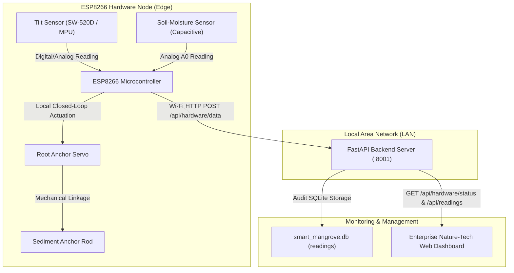

# Smart Mangrove System — ESP8266 Hardware Integration Guide

> [!NOTE]
> **Hardware Status Notice:** This document provides complete architectural specifications, pinout schematics, and configuration guidelines for integrating an **ESP8266** microcontroller node into the **Smart Mangrove System**. Because physical hardware is not currently connected to this development workstation, integration is validated via simulated network hardware telemetry clients and automated API test suites.

---

## 1. Required Components

| Component | Recommended Model | Function in Mangrove Ecosystem |
| :--- | :--- | :--- |
| **Microcontroller** | ESP8266 (NodeMCU v2/v3 or WeMos D1 Mini) | Local sensor processing, local servo control, and Wi-Fi HTTP telemetry transmission. |
| **Tilt Sensor** | SW-520D Ball Tilt Switch / MPU-6050 Inclinometer | Detects mechanical inclination or uprooting risk of the mangrove sapling. |
| **Soil Moisture Sensor** | Capacitive Soil Moisture Sensor v1.2 / Resistive probe | Measures intertidal rhizosphere hydration and tidal immersion levels. |
| **Actuator Servo** | SG90 / MG90S Micro Servo (180° metal-gear recommended) | Actuates the mechanical anchoring mechanism upon tilt detection. |
| **Anchor Mechanism** | Sub-surface anchor rod / stabilization arm linkage | Deploys into estuarine sediment to prevent young sapling uprooting. |
| **Power Supply** | 5V / 2A External USB Power or 18650 Li-ion battery + BMS | Supplies regulated 5V to the servo and 3.3V to the ESP8266. |

---

## 2. Hardware Architecture & Component Roles



### Component Roles:
1. **ESP8266 Microcontroller:**
   - Functions autonomously at the edge.
   - Evaluates sensor signals in real time without depending on the browser or laptop.
   - Maintains a local safety state machine with hysteresis to prevent servo wear.
   - Dispatches telemetry packages to the FastAPI backend at regular intervals (default 3s) and immediately upon events.

2. **Tilt Sensor:**
   - Continuously monitors the vertical alignment of the mangrove plant or its support stake.
   - When inclination exceeds the configurable threshold (e.g. >15° or digital trigger), it signals an imminent uprooting risk.

3. **Soil-Moisture Sensor:**
   - Placed in the mangrove rhizosphere mud to monitor estuarine water availability and tidal sediment saturation.
   - Output is digitized by the ESP8266 ADC and calibrated as a percentage (0–100%).

4. **Servo Motor & Anchor Mechanism:**
   - Attached mechanically to the root anchor rod.
   - **Standby Position (0°):** Anchor mechanism retracted during normal upright conditions.
   - **Anchoring Position (90°):** Rotates the anchor arm to penetrate the sediment when tilt is detected, stabilizing the sapling against wave forces.
   - **Local Decision Rule:** Immediate servo engagement is made **locally by the ESP8266**. The web dashboard reports and audits the event; it does not introduce network latency into the mechanical protection loop.

---

## 3. Wiring & Pin Configuration (Placeholders)

> [!IMPORTANT]
> Pin numbers in the firmware are **configurable placeholders**. Adjust these constants in `firmware/esp8266_mangrove_node/esp8266_mangrove_node.ino` to match your physical wiring.

| Sensor / Actuator Pin | ESP8266 NodeMCU Pin | GPIO | Firmware Constant |
| :--- | :--- | :--- | :--- |
| **Tilt Sensor Signal (DO)** | **D5** | GPIO14 | `PIN_TILT_SENSOR` |
| **Soil Moisture Signal (AOUT)** | **A0** | ADC0 | `PIN_SOIL_MOISTURE` |
| **Servo PWM Signal (Orange/Yellow)** | **D4** | GPIO2 | `PIN_SERVO` |
| **Sensor VCC** | 3V3 or 5V | — | — |
| **Servo VCC** | **External 5V** (Do not power servo directly from ESP 3V3 pin) | — | — |
| **Ground (GND)** | Common GND (Tie ESP8266 GND and Servo 5V GND together) | — | — |

---

## 4. ESP8266 Firmware Configuration

The complete Arduino/C++ firmware is located at:
`firmware/esp8266_mangrove_node/esp8266_mangrove_node.ino`

Open the `.ino` file in the **Arduino IDE** or **PlatformIO** and configure Section 1:

```cpp
// 1. Network Credentials
const char* WIFI_SSID     = "YOUR_WIFI_NETWORK_NAME";
const char* WIFI_PASSWORD = "YOUR_WIFI_PASSWORD";

// 2. FastAPI Backend Server IP & Port
// Find your laptop's LAN IP with `ipconfig` (Windows) or `ifconfig` (Linux/Mac)
const char* FASTAPI_HOST  = "192.168.1.100";  // Example: your computer's local IP
const int   FASTAPI_PORT  = 8001;             // Smart Mangrove backend port
const char* FASTAPI_PATH  = "/api/hardware/data";
const char* DEVICE_ID     = "ESP8266-001";

// 3. Servo Mechanical Angles
const int SERVO_POS_NORMAL    = 0;   // Retracted / Standby angle
const int SERVO_POS_ANCHORING = 90;  // Deployed / Anchored angle
```

---

## 5. Telemetry API Specification

The ESP8266 communicates directly with the FastAPI backend over Wi-Fi using standard HTTP POST requests.

### Endpoint:
`POST /api/hardware/data`
**Content-Type:** `application/json`

### Normal Condition Payload:
```json
{
  "device_id": "ESP8266-001",
  "source": "HARDWARE",
  "tilt": 0,
  "soil_moisture": 65.0,
  "servo_state": "NORMAL"
}
```

### Tilt Detection & Anchoring Event Payload:
```json
{
  "device_id": "ESP8266-001",
  "source": "HARDWARE",
  "tilt": 1,
  "soil_moisture": 65.0,
  "servo_state": "ANCHORING",
  "event": "TILT_DETECTED"
}
```

---

## 6. How Real Hardware is Distinguished from Simulation

The system enforces strict data isolation to ensure simulated values are never falsely labeled as authentic hardware readings:

| Operational Mode | Top Header Badge | Dashboard Source Banner | Telemetry Source Tag | History Audit Source |
| :--- | :--- | :--- | :--- | :--- |
| **Real Hardware Mode** | `🟢 Hardware: Connected` | `HARDWARE CONNECTED — Data Source: REAL HARDWARE (ESP8266-001)` | `REAL HARDWARE` | `REAL HARDWARE (ESP8266-001)` |
| **Simulation Mode** | `⚪ Hardware: Not Connected` | `Hardware: Not Connected — Data Source: SIMULATION` | `NOT CONNECTED` (or `SIMULATED`) | `SIMULATION` |
| **Test Mock Mode** (Developer Button) | `🧪 TEST CONNECTION` | `TEST CONNECTION (SOFTWARE ONLY) — Data Source: TEST MOCK` | `TEST MOCK` | `HARDWARE (TEST-DEVICE-01)` |

### Automatic Hardware Watchdog (Heartbeat):
- Every time a valid telemetry packet arrives at `POST /api/hardware/data`, the backend records the timestamp and sets `is_real_hardware = True`.
- If no telemetry is received for **30 seconds** (e.g. ESP8266 powered off or Wi-Fi dropped), the backend automatically marks hardware as **Not Connected** and the dashboard reverts to waiting state.

---

## 7. How to Start and Test

### Step 1: Start the FastAPI Backend
Open a terminal in the project directory and run:
```powershell
python -m uvicorn backend.main:app --host 0.0.0.0 --port 8001
```
*(Using `--host 0.0.0.0` allows the ESP8266 on your local Wi-Fi to reach the server).*

### Step 2: Open the Web Dashboard
Navigate in your browser to:
`http://127.0.0.1:8001/`
Sign in with credentials:
- **Username:** `Blue Guard`
- **Password:** `BG6511`

### Step 3: Test Hardware Telemetry Without Physical Hardware
Run the automated hardware client test script:
```powershell
python scripts/test_esp8266_client.py
```
This script sends authentic HTTP packets to `POST /api/hardware/data`:
1. Sends normal telemetry → Dashboard updates to `Hardware: Connected` with `Data Source: REAL HARDWARE`.
2. Sends tilt alert event → Dashboard displays `Tilt Detected` and `Anchoring Activated`.
3. Records are persisted to `smart_mangrove.db` and appear immediately in **History** and trend graphs.
